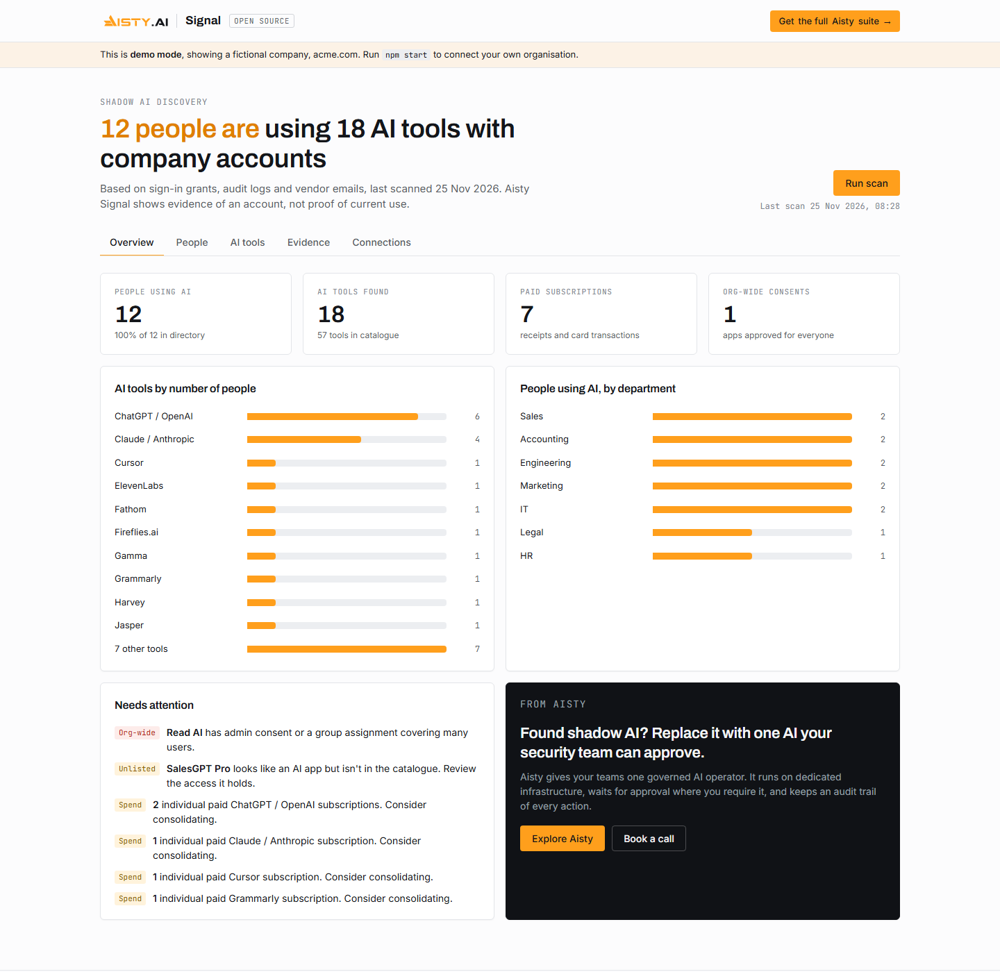
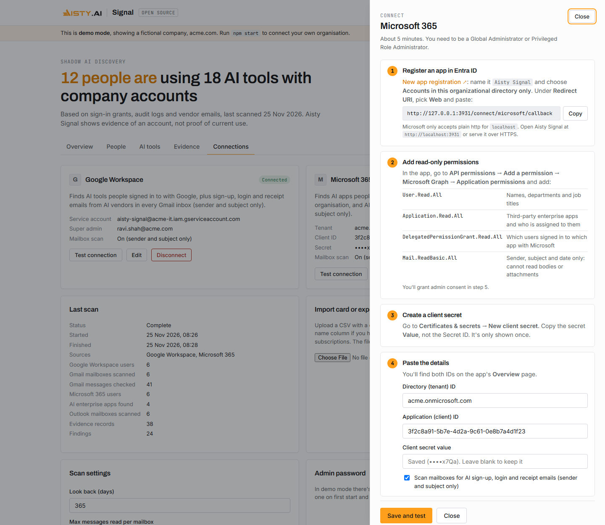
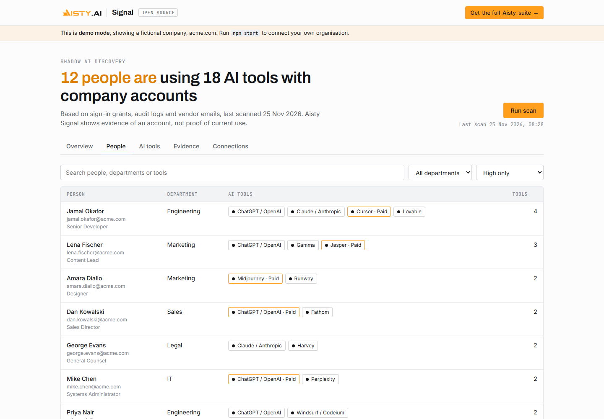
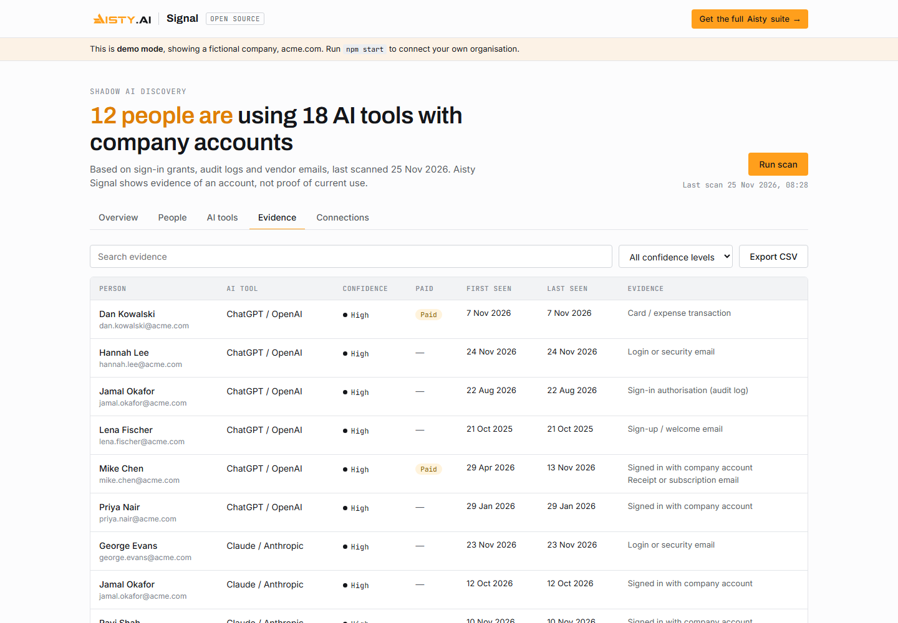
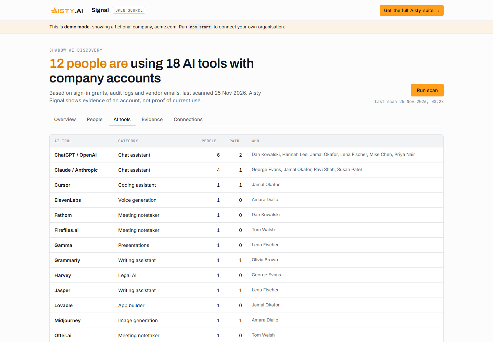
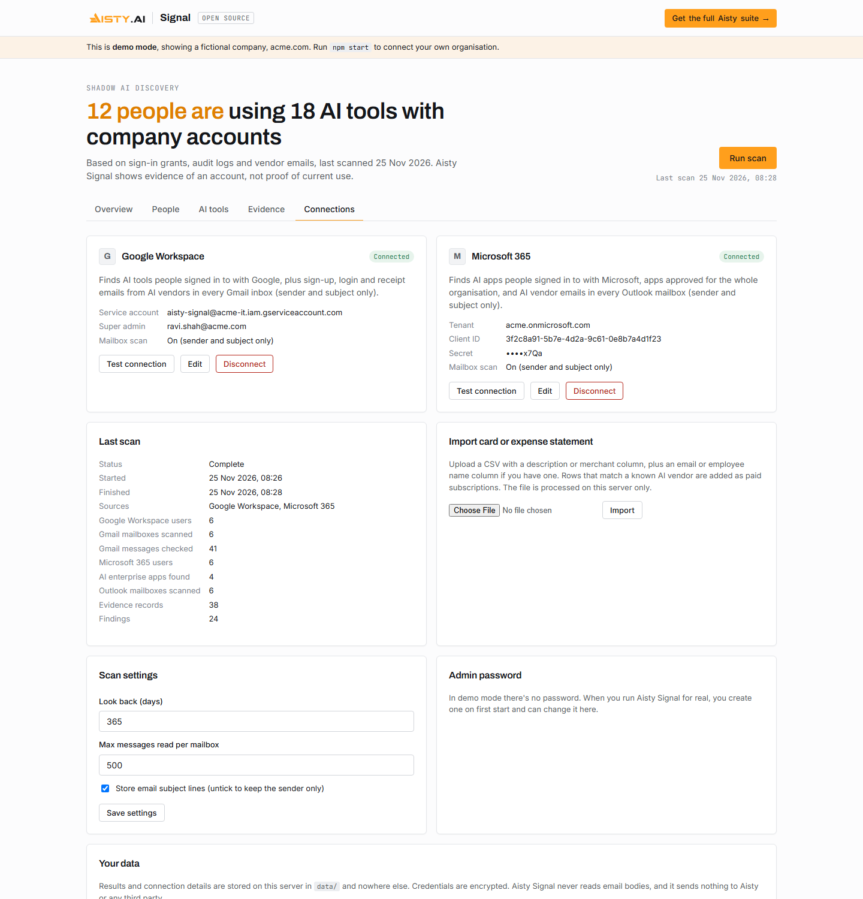

<div align="center">

# Aisty Signal

**Find every AI tool your people signed up for with a company email.**

Open-source shadow AI discovery for **Google Workspace** and **Microsoft 365**. Self-hosted, read-only, free.

[](https://github.com/AistyAI/AISTY-Signal/actions/workflows/ci.yml)
[](LICENSE)


[Quick start](#quick-start) · [How it works](#how-it-works) · [Setup guides](#connect-your-organisation) · [Privacy](docs/PRIVACY.md) · [Add an AI tool](CONTRIBUTING.md)



<sub>Demo data for the fictional company acme.com.</sub>

</div>

---

Mike in IT signed up for ChatGPT. Susan in Accounting pays for Claude on her card. Someone in Sales approved "SalesGPT Pro" to read their whole mailbox. **None of them asked.**

Aisty Signal connects to your Google Workspace or Microsoft 365 tenant with admin-approved, **read-only** permissions. It then lists every AI tool that **anyone** in your organisation has registered with a company email address, not just the admin who connected it. It shows who uses each tool, how they signed up, whether they're paying, and the evidence behind each finding.

It runs on your own machine or server. Nothing is sent to Aisty or any third party.

## Contents

- [What it finds](#what-it-finds)
- [Quick start](#quick-start)
- [Connect your organisation](#connect-your-organisation)
- [How it works](#how-it-works)
- [The dashboard](#the-dashboard)
- [Limitations](#limitations-read-this)
- [Configuration](#configuration)
- [Security model](#security-model)
- [Privacy and GDPR](#privacy-and-gdpr)
- [Contributing](#contributing)
- [FAQ](#faq)
- [Licence](#licence)

## What it finds

| Signal | Catches | Google Workspace | Microsoft 365 |
|---|---|---|---|
| **Sign-in grants** | "Sign in with Google/Microsoft" on ChatGPT, Claude, Otter and others | Directory API OAuth tokens | Enterprise apps and delegated permission grants |
| **Audit log** | Grants that were made, then revoked | Reports API token events (~180 days) | App role assignments |
| **Account emails** | Email-and-password sign-ups: welcome, verify, login-code and receipt emails from AI vendors | Gmail search, `From` and `Subject` headers only | `Mail.ReadBasic.All`: sender and subject, never bodies |
| **Card statements** | Paid subscriptions on expensed or company cards | CSV import | CSV import |

It also flags:

- **Organisation-wide consents**: an AI app an admin approved for everyone.
- **Unlisted apps whose names suggest AI** (e.g. "SalesGPT Pro"), so tools that aren't in the catalogue aren't missed silently.
- **Paid subscriptions**: receipts from AI vendors, or via Stripe, Paddle and similar, matched to the vendor.

The [vendor catalogue](catalogue/ai-vendors.json) covers **57 AI tools**:

- **Chat assistants:** ChatGPT, Claude, Perplexity, Mistral, DeepSeek, Grok and others.
- **Coding tools:** Cursor, Windsurf, Replit, Lovable, Bolt, v0.
- **Meeting notetakers:** Otter, Fireflies, Fathom, Read AI, Granola.
- **Image, video and voice generators:** Midjourney, Runway, ElevenLabs.
- **Writing, presentation and legal tools:** Jasper, Grammarly, Gamma, Harvey.

## Quick start

Requires **Node.js 22.9 or later**.

```bash
git clone https://github.com/AistyAI/AISTY-Signal.git
cd AISTY-Signal
npm install
npm run demo
```

Open **http://127.0.0.1:3000** to explore the dashboard with fictional data. You don't need any credentials.

### Run it for real

```bash
npm run build
npm start
```

1. Open **http://localhost:3000**.
2. **Create your admin password.** To prove you control the server, enter the one-time **setup code printed in the terminal**.
3. Go to **Connections** and click **Connect Google Workspace** or **Connect Microsoft 365**.
4. Follow the step-by-step wizard, then click **Run scan**.

You don't need a `.env` file. Everything is configured in the browser, and credentials are encrypted at rest.

### Docker

```bash
docker build -t aisty-signal .
docker run -d --name aisty-signal \
  -e HOST=0.0.0.0 -p 127.0.0.1:3000:3000 \
  -v signal-data:/app/data aisty-signal
docker logs aisty-signal   # shows the first-run setup code
```

## Connect your organisation

Each install registers its own app in your tenant, so no third party (including Aisty) ever holds credentials to your organisation. The in-app wizards link to each admin page and give you the exact values to copy and paste.

<table>
<tr>
<td width="50%" valign="top">

**Google Workspace**: about 10 minutes, super admin

1. Enable the Admin SDK and Gmail APIs.
2. Create a service account and upload its JSON key.
3. Authorise domain-wide delegation. The wizard shows the Client ID and scopes to paste.
4. Enter a super admin email, then click **Connect and test**.

[Full guide →](docs/SETUP-GOOGLE.md)

</td>
<td width="50%" valign="top">

**Microsoft 365**: about 5 minutes, Global Admin

1. Register an app in Entra ID with the redirect URI the wizard gives you.
2. Add four read-only Graph application permissions.
3. Create a client secret and paste the IDs and secret.
4. Click **Grant admin consent**, then **Save and test**.

[Full guide →](docs/SETUP-MICROSOFT.md)

</td>
</tr>
</table>

<div align="center">

</div>

### Permissions requested

All permissions are read-only.

| Google Workspace scope | Used for |
|---|---|
| `admin.directory.user.readonly` | Names, departments and job titles |
| `admin.directory.user.security` | Each user's third-party OAuth tokens |
| `admin.reports.audit.readonly` | Token authorisation events, including revoked grants |
| `gmail.readonly` | Searching for AI vendor senders, then reading only the `From` and `Subject` headers. Optional. |

| Microsoft Graph permission (application) | Used for |
|---|---|
| `User.Read.All` | Names, departments and job titles |
| `Application.Read.All` | Third-party enterprise apps and who is assigned to them |
| `DelegatedPermissionGrant.Read.All` | Which users signed in to which app with Microsoft |
| `Mail.ReadBasic.All` | Sender, subject and date only. It can't read bodies or attachments. Optional. |

You can turn off mailbox scanning per connection, so Signal checks sign-in grants only.

## How it works

```
┌──────────────────────┐   read-only API calls  ┌───────────────────────────┐
│ Google Workspace     │ ─────────────────────▶ │                           │
│ Directory · Reports  │                        │       Aisty Signal        │
│ Gmail (headers only) │                        │   (your machine/server)   │
└──────────────────────┘                        │                           │
┌──────────────────────┐                        │  match against catalogue  │
│ Microsoft 365        │ ─────────────────────▶ │  classify each email      │
│ Entra apps · grants  │                        │  merge per person + tool  │
│ Mail (ReadBasic)     │                        │                           │
└──────────────────────┘                        └─────────────┬─────────────┘
┌──────────────────────┐                                      │
│ Card statement CSV   │ ────────────────────────────────────▶│ data/ (local, 0600)
└──────────────────────┘                                      ▼
                                                     Dashboard · CSV export
```

1. **Directory.** Signal lists every user, so findings are attributed to real people and departments.
2. **Sign-in grants.** For each user, it reads the third-party apps they've authorised and matches the app names against the catalogue.
3. **Mailboxes.** For each user, it searches for messages from AI vendor domains, for example `from:(openai.com OR anthropic.com …)`, and reads only the sender and subject. Each message is classified:
   - **Sign-up or welcome:** high confidence.
   - **Login or security code:** high confidence.
   - **Receipt or invoice:** high confidence, marked paid.
   - **Anything else:** low confidence, probably marketing.
4. **Merge.** Evidence is grouped per person and tool, with first-seen and last-seen dates and an overall confidence level.

## The dashboard

| | |
|---|---|
|  |  |
| **People**: everyone with an AI account, their department and tools. Click a row to see the evidence. | **Evidence**: every finding with confidence level, paid flag and dates. Export to CSV. |
|  |  |
| **AI tools**: each tool, how many people use it and how many pay. | **Connections**: connect, test and disconnect tenants, scan settings, CSV import, last-scan stats. |

The **Overview** shows headline numbers, top tools, a breakdown by department, and items that need attention: org-wide consents, unlisted AI apps and duplicate paid subscriptions.

### Confidence levels

| Level | Meaning |
|---|---|
| **High** | Sign-in grant, app assignment, audit-log authorisation, sign-up, login or receipt email, or a card transaction |
| **Low** | Other vendor email (possibly a newsletter), or an unlisted app whose name suggests AI |

## Limitations (read this)

- **It shows evidence, not proof.** AI vendors don't publish an API that lists the accounts on your domain. Signal infers accounts from the traces they leave in your tenant.
- **It misses some accounts:**
  - sign-ups whose emails were deleted, or are older than your retention or lookback window
  - personal email addresses
  - tools used without an account
  - browser extensions, and API keys paid for on personal cards

  Pair it with network or browser controls for full coverage.
- **Gemini and Microsoft Copilot** are first-party services. Manage them in the Google and Microsoft admin consoles.
- **The connectors are new.** They've been tested against the API contracts and error responses, and in demo mode. Please [report issues](https://github.com/AistyAI/AISTY-Signal/issues) from real tenants.

## Configuration

Everything is managed in the dashboard: connections, scan settings (lookback window, messages per mailbox, whether to store subject lines) and the admin password. A `.env` file is **optional**. It's useful for server settings and headless installs. See [`.env.example`](.env.example).

| Variable | Default | Description |
|---|---|---|
| `HOST` / `PORT` | `127.0.0.1` / `3000` | Keep it on localhost unless it sits behind HTTPS and a reverse proxy |
| `SIGNAL_DATA_DIR` | `./data` | Where settings and results are stored |
| `SIGNAL_ENCRYPTION_KEY` | auto-generated in `data/secret.key` | Encrypts saved credentials. Set it to keep the key out of the data folder |
| `SIGNAL_ADMIN_PASSWORD` | (none) | Sets the password from the environment instead of the UI |
| `SCAN_LOOKBACK_DAYS`, `SCAN_MAX_MESSAGES_PER_USER`, `SCAN_CONCURRENCY`, `SIGNAL_STORE_SUBJECTS` | `365`, `500`, `5`, `true` | Defaults for scan settings |
| `GOOGLE_*`, `MS_*` | (none) | Connect without the UI. A connection saved in the UI takes precedence |

## Security model

- **Read-only.** No permission requested can change, send or delete anything in your tenant.
- **Encrypted credentials.** The Google key and Microsoft secret are encrypted with AES-256-GCM in `data/settings.json` (mode `0600`). They're write-only in the UI: you'll only ever see the service account email or the last four characters of the secret.
- **Setup code.** The first visitor can't claim the dashboard without the one-time code printed to the server console. Passwords are hashed with scrypt.
- **Hardened web app:**
  - binds to `127.0.0.1` by default
  - signed `HttpOnly` `SameSite=Strict` session cookies
  - CSRF header check
  - rate-limited login
  - strict Content Security Policy
  - all email-derived text is HTML-escaped (subject lines are attacker-controlled)
  - CSV export neutralises spreadsheet formulas
- **Metadata only.** Microsoft uses `Mail.ReadBasic.All`, which can't read bodies. Google uses `format=metadata` with the `From` and `Subject` headers. Google's narrower `gmail.metadata` scope doesn't allow search, so `gmail.readonly` is required. You can audit the code that uses it in [`src/providers/google.ts`](src/providers/google.ts).

To report a vulnerability, see [SECURITY.md](SECURITY.md).

## Privacy and GDPR

Scanning mailbox metadata processes personal data. In the UK and EU you'll typically need:

- a lawful basis (usually legitimate interests)
- a DPIA
- a notice to staff

[docs/PRIVACY.md](docs/PRIVACY.md) explains exactly what's read and stored, and includes a checklist. Turn off **Store email subject lines** to keep the sender only. **Delete all results** wipes everything.

## Contributing

The most valuable contribution is **adding AI tools to the catalogue**. It's a JSON entry with the tool's email domains, OAuth app names and billing text. See [CONTRIBUTING.md](CONTRIBUTING.md) or [open an "Add an AI tool" issue](https://github.com/AistyAI/AISTY-Signal/issues/new?template=new-ai-tool.yml).

```bash
npm run dev        # watch mode
npm test           # unit tests
npm run typecheck
```

```
catalogue/ai-vendors.json   community-maintained list of AI tools
src/providers/google.ts     Google Workspace connector
src/providers/microsoft.ts  Microsoft 365 connector
src/settings.ts             UI-managed connections, encryption, password
src/classify.ts             email → evidence classification
src/scan.ts                 scan orchestration
src/server.ts               Express API + static dashboard
public/                     dashboard (plain HTML/CSS/JS, no build step)
test/                       unit tests
```

## FAQ

**Why not a one-click "Sign in with Google/Microsoft" button?**
A normal sign-in only gives access to the signed-in admin's own mailbox, so it wouldn't find Susan's ChatGPT account. Reading every user's directory entries and mailbox headers needs an organisation-level app: a Google service account with domain-wide delegation, or an Entra app with admin consent. Because Signal is self-hosted, you register that app yourself, and no one else holds the keys.

**Does it read email content?**
No. It reads the sender and subject of messages from a fixed list of AI vendor and payment-processor domains, nothing else.

**Can employees tell it's running?**
The scan doesn't modify anything or send notifications. You should still tell staff. See [Privacy and GDPR](#privacy-and-gdpr).

**What about Slack, Okta or browser history?**
Not yet. Signal focuses on the email and identity evidence trail. Contributions are welcome.

**What's the relationship to Aisty?**
Aisty Signal is a free, standalone, MIT-licensed tool built by [Aisty](https://www.aisty.ai/?utm_source=aisty-signal&utm_medium=github). Once you've found shadow AI, Aisty gives your teams one governed AI operator instead. It runs on dedicated infrastructure, with approval thresholds and an audit trail of every action. You don't need Aisty to use Signal.

## Licence

[MIT](LICENSE) © 2026 One To Infinity Power LTD (Aisty). "Aisty" and the Aisty logo are trademarks of One To Infinity Power LTD. The MIT licence covers the code, not the brand.

<div align="center">
<br>
<a href="https://www.aisty.ai/?utm_source=aisty-signal&utm_medium=github"><strong>Get the full Aisty suite →</strong></a>
</div>
